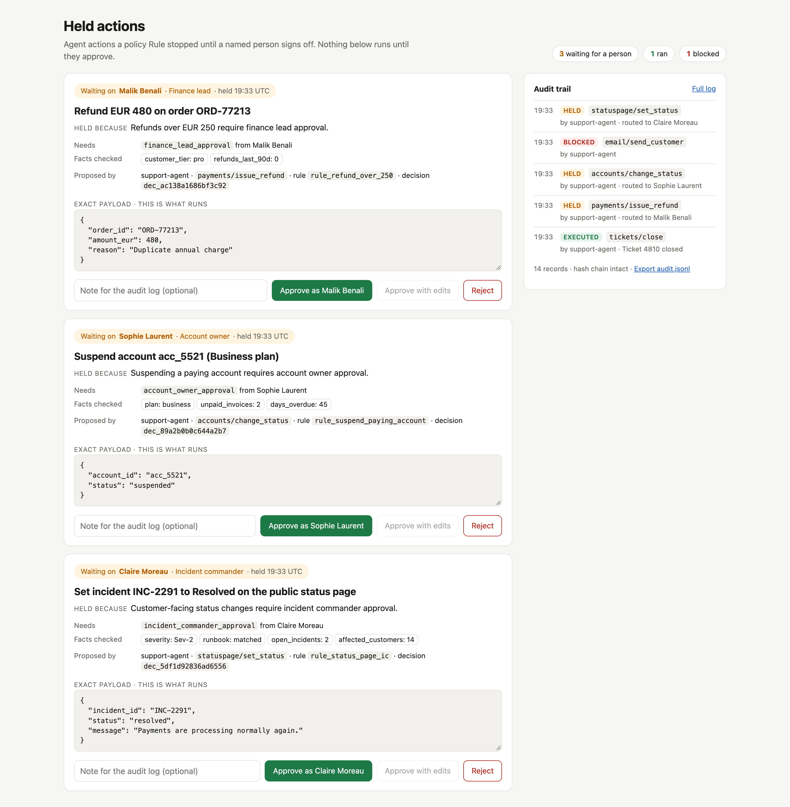
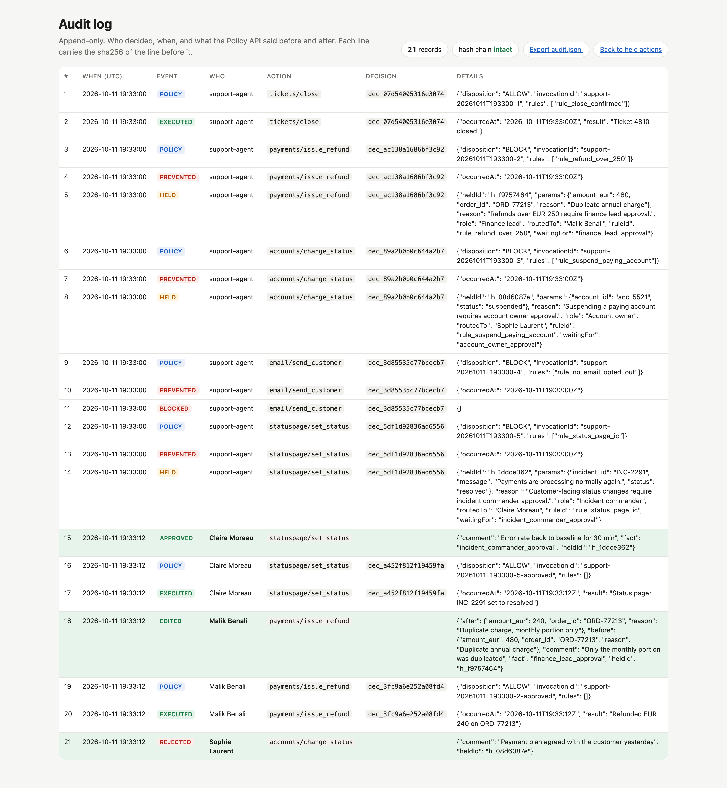

# Held actions

An approval loop for Rippletide policy decisions.

- When a Rule blocks an agent action that a named person is allowed to lift, the action is held instead of dropped, and routed to that person.
- The approver sees one screen: who proposed it, the exact payload, why it was held, the facts checked. They approve, edit or reject.
- Approval goes back to the Policy API as a trusted context fact, the action is re-checked, then run or dropped, and every step lands in an append-only, hash-chained `audit.jsonl`.



## Run it

```bash
cd rippletide-approval-loop
python3 tests/test_loop.py        # hold, approve, reject, edit, audit log, page guards
python3 server.py                 # local mock Policy API + scripted agent, then open http://127.0.0.1:8765
```

Python 3.9+, standard library only. No account, no keys, no outbound calls: the Policy API is a local mock (`mock_policy_api.py`).
To use a real Connection, set `RIPPLETIDE_BASE_URL` and `RIPPLETIDE_API_KEY` and declare the catalogue; the client already speaks the documented HTTP calls.

## How it maps to the docs

| Docs say | This loop does |
| - | - |
| Dispositions are `ALLOW`, `WOULD_BLOCK`, `BLOCK`; approvals are "not a separate generic Escalate disposition" | A Rule blocks until a context fact such as `finance_lead_approval` is present. A `BLOCK` from a Rule in the routing table is held for that Rule's approver. Any other `BLOCK` is final. |
| Context facts must come from the trusted runtime, not the agent | Approval facts are stripped from agent input. Only the approver's decision adds them. |
| "Use a new invocation ID for every real attempt" | After approval the action is re-decided as `<invocationId>-approved`. It runs only if that decision allows it, so an edit cannot slip past another Rule. |
| Receipts: `EXECUTED` means the handler was invoked, `PREVENTED` means it was not | The held attempt gets `PREVENTED`; the released attempt gets `EXECUTED`. |
| Invalid schemas are errors, not Allow | A bad edit comes back as a 400 from the Policy API. Nothing is recorded and the action stays held. |

The page binds 127.0.0.1 only, checks `Host` and `Origin`, accepts JSON-only POSTs, escapes every rendered value and sends a nonce CSP. There is no login locally, so each card acts as its routed approver. Behind SSO, take the approver from the session.



## Based on

- What is Rippletide: https://docs.rippletide.com
- Policy API: https://docs.rippletide.com/docs/policy-api
- Observe & enforce: https://docs.rippletide.com/docs/observe-and-enforce
- Privacy & capture (context is stored in the decision audit trail): https://docs.rippletide.com/docs/privacy
- Traces (human interventions): https://docs.rippletide.com/docs/runtime-events
- The "held for approval" scenario on https://www.rippletide.com

Not documented publicly, so assumed in the mock: the field name and shape of the rule snapshot in a decision (`rules[]` with `ruleId`, `effect`, `mode`, `reason`), the `outcome: UNDETERMINED` / `reason: NO_MATCH` field names, and the error body shape.
